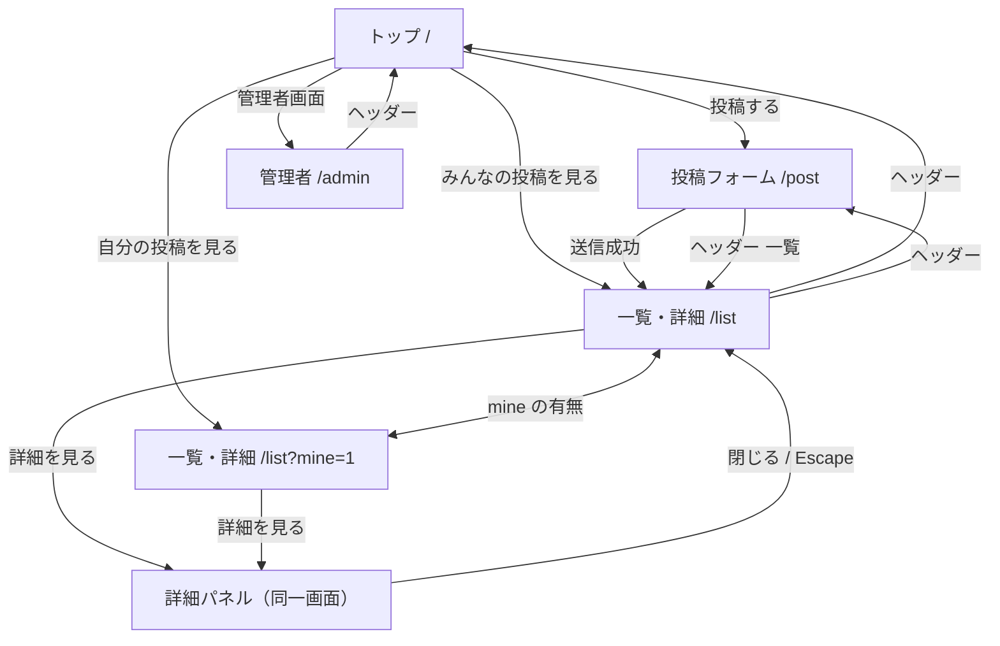

# 画面遷移

実装済みの画面と遷移だけを書く。見た目の仕様は [DESIGN.md](../DESIGN.md) を参照する。

公開時は `HashRouter` のため、ブラウザ上のパスは `/#/...` になる。以下はアプリ内のルート表記。

---

## 画面一覧

| 画面 | ルート | 役割 |
|------|--------|------|
| トップ | `/` | サマリー、最近の投稿、各画面への導線 |
| 投稿フォーム | `/post` | 投稿の作成・下書き保存 |
| 投稿一覧・詳細 | `/list` | みんなの投稿。詳細は**同じ画面内のパネル** |
| 自分の投稿一覧 | `/list?mine=1` | 上記と同じ画面。`mine=1` で自分の投稿のみ |
| 管理者 | `/admin` | ステータス・回答・削除（認証なし PoC） |

詳細専用のルートやモーダルは無い。

---

## 画面遷移図

---

## 遷移条件

| 操作 | 結果 |
|------|------|
| トップ「投稿する」 / ヘッダー「投稿する」 | `/post` |
| トップ「みんなの投稿を見る」 / ヘッダー「みんなの投稿」 | `/list`（`mine` を付けない） |
| トップ「自分の投稿を見る」 / ヘッダー「自分の投稿」 | `/list?mine=1` |
| 一覧の「自分の投稿のみ」チェック | 他のクエリは残し、`mine=1` の付与または削除 |
| 投稿フォームで送信 | タイトル・本文が空でなければ `/list`。Repository の `create` 経由 |
| 一覧の「詳細を見る」 | ルートは変えず、画面内パネルを開く |
| 詳細の「閉じる」または Escape | パネルを閉じ、操作した「詳細を見る」へフォーカス |
| 表示中の投稿が一覧フィルタから外れる | パネルを閉じる |
| トップの最近の投稿 | 詳細へは進まない（クリック用の見た目にしない） |

共感は一覧カード上で完結し、画面遷移しない。

管理者画面の詳細も画面内パネル。導線の改善対象外。
